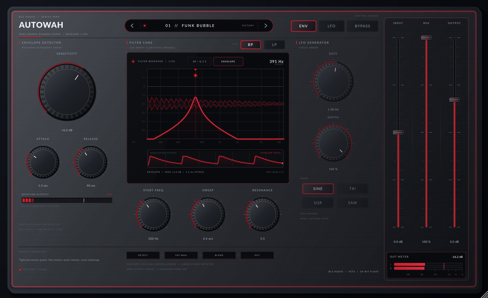
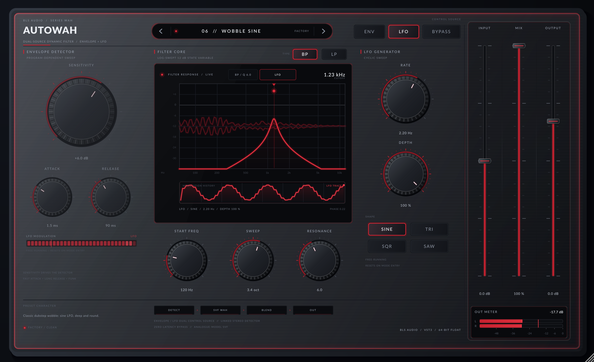

# Auto-Wah

A dual-source dynamic wah filter for VST3 hosts and standalone use, built with
JUCE 8.0.8. The signature feature is a click-free switch between two completely
different modulation engines:

- **ENVELOPE** — a stereo-linked, sensitivity-scaled envelope follower with
  independent attack and release times drives the filter. Playing dynamics
  become the wah.
- **LFO** — a free-running LFO with sine, triangle, square and up-saw shapes and
  a dedicated rate/depth section drives the filter. The wah becomes rhythmic.

Both sources modulate the same analogue-modelled resonant state-variable filter
in the log-frequency domain, so switching sources glides instead of clicking or
jumping.



*Envelope mode: the detector section is live, while the inactive LFO section is dimmed but still editable.*



*LFO mode: the envelope section dims, the LFO scope and phase playhead take over, and the response curve tracks the cyclic sweep.*

## Highlights

- Envelope detector and LFO control sources, switchable from the top panel or
  through host automation (`mode` parameter).
- Stereo-linked peak detector with **Sensitivity**, **Attack** and **Release**.
- Free-running LFO with **Rate**, **Depth** and four shapes (sine, triangle,
  square, saw); the LFO phase resets when entering LFO mode for repeatable takes.
- Bandpass or lowpass 12 dB/octave topology-preserving-transform state-variable
  filter with **Start Frequency** (80 Hz – 6 kHz), a 0–6 octave **Sweep** and
  **Resonance** up to Q 14.
- Log-domain cutoff smoothing, resonance makeup, valve-like peak control and a
  zero-latency bypass crossfade.
- Mix, input trim, output level and a zero-latency bypass crossfade.
- 10 factory presets split across both control sources.
- Gunmetal/glass studio-hardware UI with a live filter-response screen, audio
  waveform, moving cutoff cursor and scrolling modulation history.
- Full-height right-side mixer bay: Input, Wet/Dry Mix and Output faders with a
  horizontal stereo Output meter (L/R bars, dB scale and peak hold) beneath them.
- Lock-free telemetry: audio waveform and modulation data reach the UI without
  locks, allocations or audio-thread work on the message thread.

## Signal path

```text
input ──┬─────────────────────────────────────────────── dry ──┐
        │                                                      ├── mix ── output
        └── detector / LFO ── log cutoff ── SVF (BP | LP) ── wet┘
                                      │
                                      └── cutoff / envelope / waveform telemetry
```

The detector is stereo-linked (maximum of the two rectified channels), scaled by
Sensitivity (‑24 dB to +24 dB) and shaped by a soft exponential curve before it
reaches the sweep depth. The LFO is free-running and unipolar; Depth scales its
contribution. Cutoff is smoothed in log2 space and the SVF coefficients are
updated at a 6 kHz control rate for zipper-free sweeps at any buffer size.

## Parameters

| ID | Name | Range | Notes |
| --- | --- | --- | --- |
| `mode` | Control Source | Envelope / LFO | Signature modulation switch |
| `filterType` | Filter Type | Bandpass / Lowpass | 12 dB/oct SVF tap |
| `startFreq` | Start Frequency | 80 Hz – 6 kHz | Filter floor / LFO low point |
| `sweep` | Sweep Range | 0 – 6 octaves | Envelope/LFO sweep depth in octaves |
| `resonance` | Resonance | Q 0.5 – 14 | Resonant peak and vocal character |
| `sensitivity` | Sensitivity | ‑24 – +24 dB | Drives the envelope detector |
| `attack` | Attack | 0.5 – 100 ms | Envelope attack |
| `release` | Release | 10 ms – 1.2 s | Envelope release |
| `lfoRate` | LFO Rate | 0.05 – 12 Hz | Free-running LFO frequency |
| `lfoDepth` | LFO Depth | 0 – 100 % | LFO sweep scaling |
| `lfoShape` | LFO Shape | Sine / Triangle / Square / Saw | Shape selector |
| `input` | Input | ‑24 – +24 dB | Input trim into the detector and filter |
| `mix` | Mix | 0 – 100 % | Dry/wet blend |
| `output` | Output | ‑24 – +12 dB | Output trim |
| `bypass` | Bypass | Off / On | Zero-latency dry crossfade |

## Factory presets

1. Funk Bubble — tight percussive envelope quack
2. Mu-Tron Sweep — deep retro bandpass with a long release
3. Talking Lead — resonant vowel-like lead voice
4. Slap Bass — sub-friendly dynamic bass wah
5. Slow Morph — slow ambient envelope bloom
6. Wobble Sine — classic dubstep sine LFO wobble
7. Trem Wah — square-wave rhythmic chop
8. Phase Rider — slow triangle sweep
9. Dub Wobble — dark lowpass LFO wobble
10. Neon Pulse — bright rising saw sweep

## Build

The repository builds against a local JUCE 8.0.8 checkout when
`external/JUCE/CMakeLists.txt` exists, and falls back to `FetchContent` on CI.

```bash
./scripts/setup-linux.sh   # links ../plugin_poc external/JUCE and deps/sysroot
./scripts/build.sh
```

Build artefacts:

- `dist/Auto-Wah.vst3` — VST3 plugin
- `dist/Auto-Wah` — standalone application
- `build/AutoWahTests_artefacts/Release/AutoWahTests`
- `build/AutoWahHostSmokeTest_artefacts/Release/AutoWahHostSmokeTest`
- `build/AutoWahScreenshot_artefacts/Release/Auto-Wah Screenshot`

## Verification

```bash
./scripts/build.sh
./build/AutoWahTests_artefacts/Release/AutoWahTests
./build/AutoWahHostSmokeTest_artefacts/Release/AutoWahHostSmokeTest dist/Auto-Wah.vst3
xvfb-run -a "./build/AutoWahScreenshot_artefacts/Release/Auto-Wah Screenshot" --out=dist/autowah-ui.png --preset=0
xvfb-run -a "./build/AutoWahScreenshot_artefacts/Release/Auto-Wah Screenshot" --out=dist/autowah-ui-lfo.png --preset=5
```

The offline suite covers the SVF stability, envelope ballistics, sensitivity,
input trim, LFO shapes and depth, bandpass/lowpass attenuation, live mode
switching, exact bypass, waveform telemetry, mono/stereo/high-sample-rate
processing, factory presets and full state round-trips. The host smoke test
instantiates the built VST3 in JUCE's VST3 host, verifies all 15 parameters and
10 programs, exercises the control-source switch and round-trips state through
the host.

## Architecture

```text
Source/
  Parameters.h          Stable parameter IDs, ranges, layout and formatters
  Presets.h             Ten deterministic factory presets
  PluginProcessor.*     APVTS, engine parameters, telemetry, waveform FIFO, state
  PluginEditor.*        1180x720 design canvas and AffineTransform scaling
  dsp/AutoWahEngine.h   Envelope follower, LFO, TPT SVF and wah voice
  ui/Theme.*            Gunmetal, glass and muted-crimson palette + chassis
  ui/StudioLookAndFeel.* Knurled knobs, glass faders, glowing tactile buttons
  ui/Controls.*         Parameter controls, preset pill, meters
  ui/FilterDisplay.*    Response curve, waveform, cutoff cursor, modulation trace
Tests/DspTests.cpp      Offline deterministic DSP tests
Tools/HostSmokeTest.cpp VST3 host scan + state round-trip
Tools/RenderEditor.cpp  Headless 2x UI renderer
```

## CI and releases

`.github/workflows/build.yml` builds and tests Windows x64 (VS 2022), Linux x64
and macOS Universal (`arm64` + `x86_64`) packages. Pushing a `v*` tag or running
the workflow manually with a `release_tag` publishes the three archives and
SHA-256 checksums as a GitHub Release.

## Licence

The plugin source is provided as-is. Bundled Lato fonts are licensed under the
SIL Open Font License; see `Resources/Lato-OFL.txt`.
